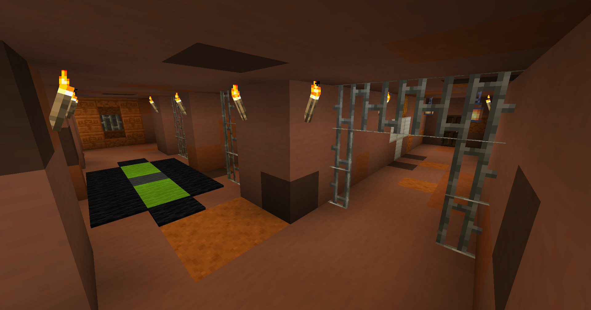
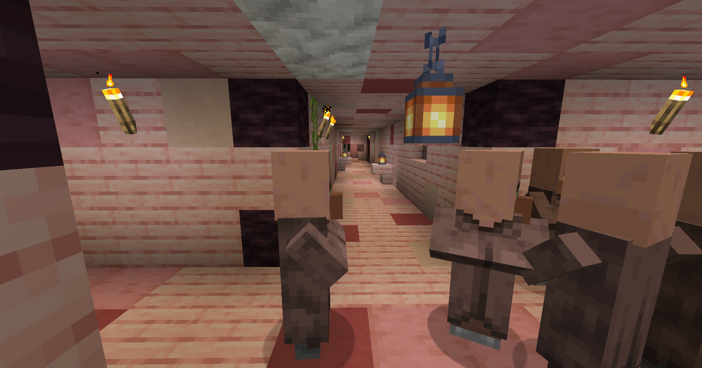
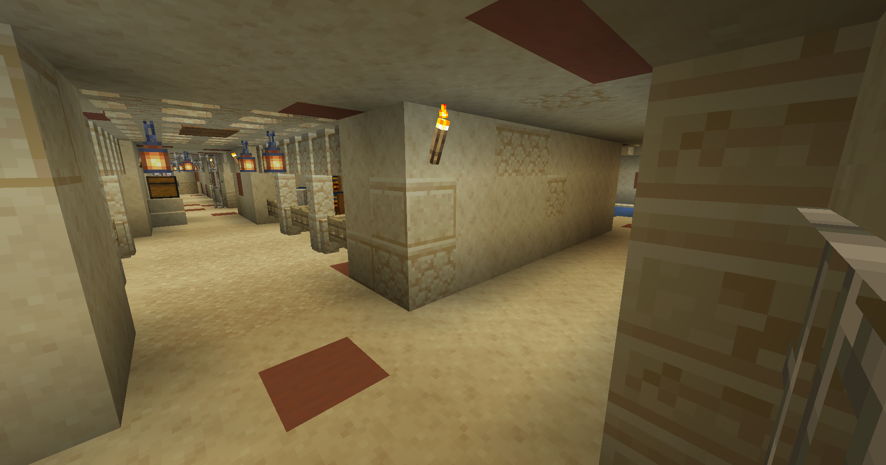
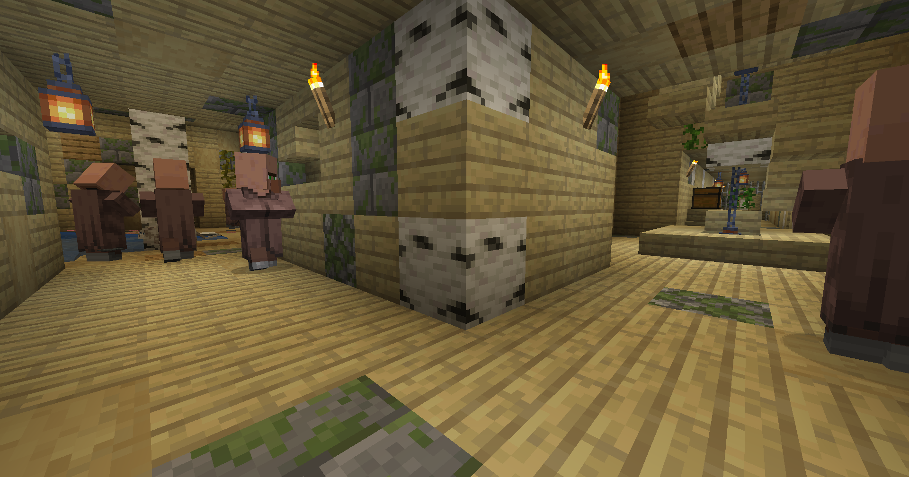
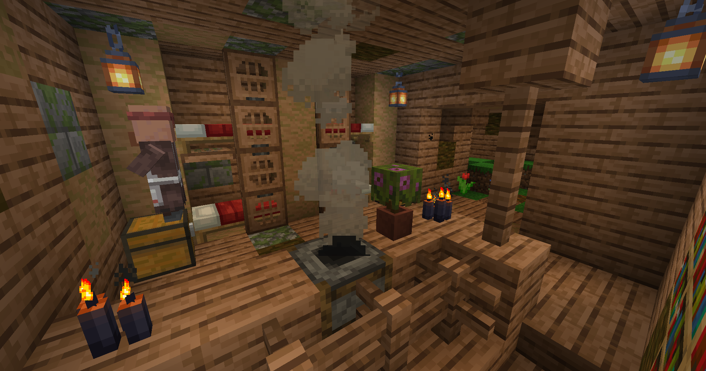
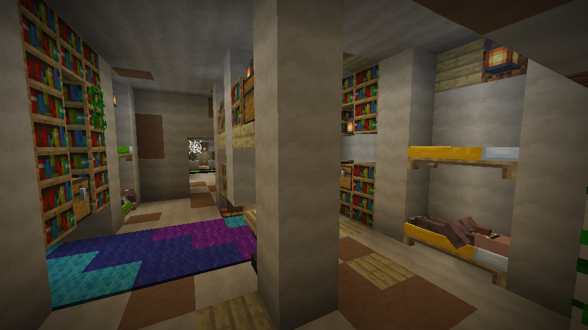
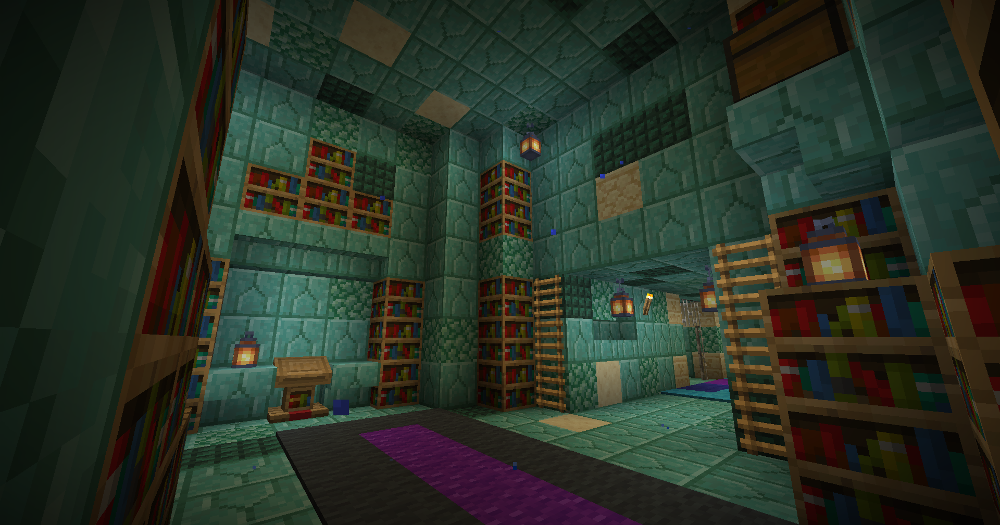
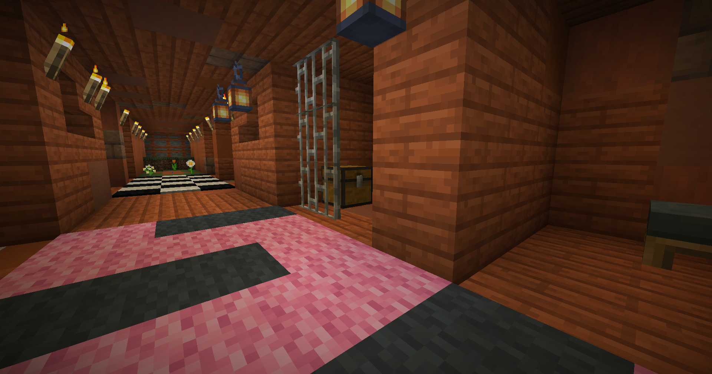
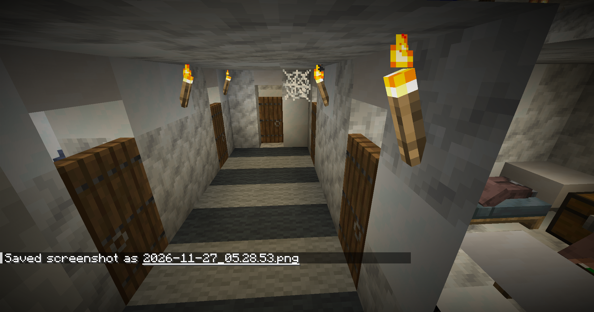
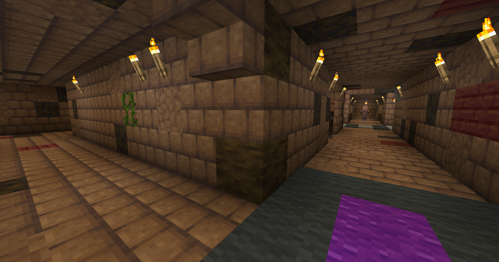

ChangeLog 
# [NEW] [Version:3.1.2]

Minecraft Version: 1.21.1, 26.1, 26.3 ( Neoforge and Fabric )
Date: Nov 27, 2026

The Update will be live soon :- https://www.curseforge.com/minecraft/mc-mods/underground-villages-stoneholm
checkout full changelogs with image on discord :- https://discord.gg/JBFNW3wdTm

## What's New

- **Biome-Themed Underground Villages**: Underground villages now match the biome above them! Discover **14 unique styles** across Desert, Badlands, Jungle, Plains, Forest, Taiga, Snowy, Savanna, Swamp, Dark Forest, Cherry Grove, Mushroom Fields, Mountain, and Ocean biomes.
- **Natural Wall & Floor Variety**: Underground walls, floors, and pillars now blend matching blocks naturally so every room looks detailed and atmospheric.
- **Modded Biome Support**: Villages generating beneath modded biomes automatically pick a matching building style (can also be turned off in the config settings if you prefer the classic look).
- **Unified Ocean Village**: Merged the underwater and ocean villages into a single **Ocean Village** built with prismarine and sandstone blocks.
- **Find Any Biome Village with `/locate`**: You can now locate specific biome villages directly using commands like `/locate structure underground_village:desert_village`, `cherry_grove_village`, `ocean_village`, `snowy_village`, and more.
- **Hanging Wall Vines**: Added subtle decorative vines along underground walls to give older corridors extra life.
- **Better Village Spacing**: Adjusted how often villages spawn so they feel closer to normal vanilla villages while exploring.

## Fixed

- **Multiplayer Server Startup Crash**: Fixed an issue that caused dedicated servers to crash on startup.
- **No More Exposed Underground Rooms**: Underground hallways and rooms now stay properly buried underground instead of poking out of hillsides—only the surface entrance stays above ground.
- **Much Faster `/locate` Command**: Fixed severe lag and screen freezing when searching for nearby underground villages with `/locate`.
- **Smoother Village Generation**: Improved world generation stability and fixed missing or broken structure pieces across supported Minecraft versions.

## Screenshots

### Badlands Underground Village

### Cherry Grove Underground Village

### Desert Underground Village

### Forest Underground Village

### Jungle Underground Village

### Mushroom Fields Underground Village

### Ocean Underground Village

### Savanna Underground Village

### Snowy Underground Village

### Swamp Underground Village

------------------------------------------------------------------------------------------------------------
# [OLD] [Version:3.1.1]

Minecraft Version: 1.20.1, 1.21.1, 26.1, 26.3 ( Neoforge and Fabric )
Date: Nov 24, 2026

The Update will be live soon :- https://www.curseforge.com/minecraft/mc-mods/underground-villages-stoneholm
checkout full changelogs with image on discord :- https://discord.gg/JBFNW3wdTm

## Added / Improved

- Multi-version architecture supporting 1.20.1, 1.21.1, 26.1, and 26.3 on both Fabric and NeoForge
- Upgraded configuration system to Better Library format with YAML config
- Interactive in-game Config Screen with categorized tabs (Underground, Water Structures, Structure Placement, Messages)
- ModMenu (Fabric) and NeoForge config screen integration
- Dynamic window placement in `afterPlace` replacing pink concrete placeholder blocks with stained glass panes or iron bars
- Optimized structure spawning checks to ensure reliable village generation without terrain lag
- Enabled expansion hack for subterranean structure generation from surface entrances

## Fixed

- Added mod-loaded conditions to worker loot tables to prevent crashes when Create is not installed
- Added automated processor list codec translation for 26.3 (`Name`/`Properties` -> `id`/`properties`)

------------------------------------------------------------------------------------------------------------
# [OLD] [Version:1.5.7]

Minecraft Version: 1.20.1-1.21.11 ( Neoforge,Forge and fabric )
Date: Dec 14, 2025

The Update will be live soon :- https://www.curseforge.com/minecraft/mc-mods/underground-villages-stoneholm
checkout full changelogs with image on discord :- https://discord.gg/JBFNW3wdTm

## Added / Improved
- Placement spacing
- Placement separation
- All placement values are now config-driven instead of hardcoded

## Removed

- Diamonds
- Emeralds
- Enchanted books
- Golden apples
- Diamond tools

## Reduced

- Total loot rolls per chest
- Resource quantities (iron, redstone, coal)
- Food stack sizes
- Arrow counts

## Tool Changes

- Iron tools are now rare
- Spawn with very high damage
- No longer guaranteed in every chest

## Loot Focus Shift

- Mostly basic food items
- Low-tier materials (sticks, nuggets, coal)
- Utility scraps instead of progression boosts

## Result

- Chests no longer accelerate progression
- Exploration feels grounded and fair
- Loot matches abandoned / common structure theme

------------------------------------------------------------------------------------------------------------
# [OLD] [Version:1.5.5]

Minecraft Version: 1.20.1-1.21.6 ( Neoforge,Forge and fabric )
Date: August 2, 2025

The Update will be live soon :- https://www.curseforge.com/minecraft/mc-mods/underground-villages-stoneholm
checkout full changelogs with image on discord :- https://discord.gg/JBFNW3wdTm

New Added

5 New Entrances

5 New large stairs

3 New bedrooms

2 New crypt stairs

2 New hallways

6.The structure will also spawn in the ocean. 

------------------------------------------------------------------------------------------------------------
# [OLD] [Version:1.5.4]

## Added :
- Configurable size From Config Menu
- Configurable max Distance From Center From Config Menu

## Fixed :
- Loottable
- Structure placement
