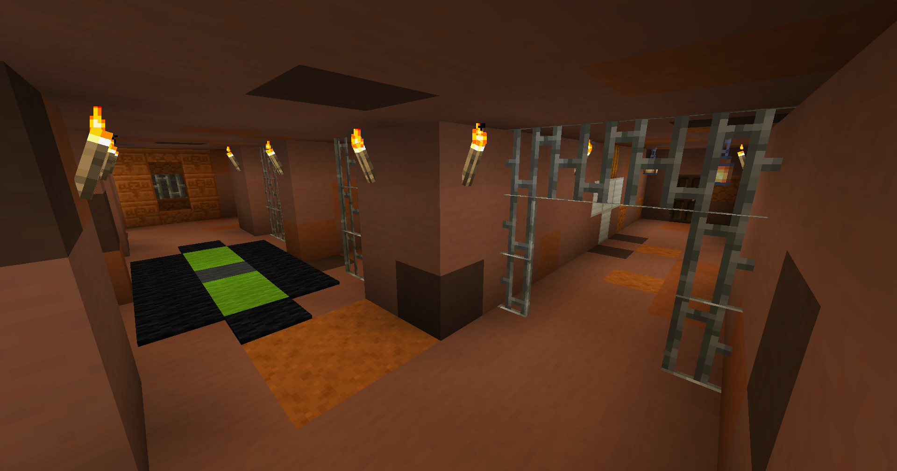
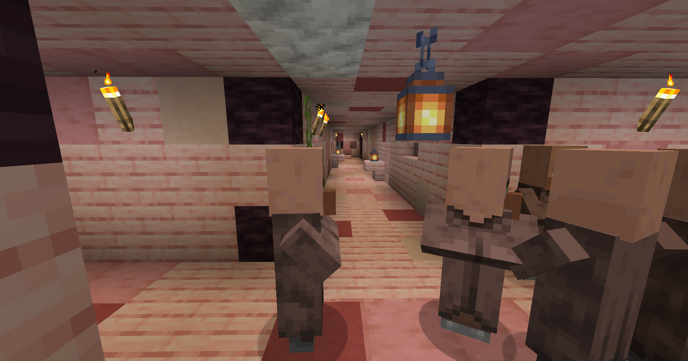
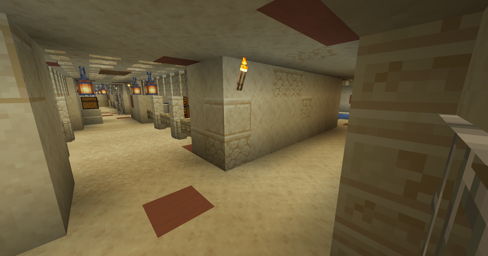
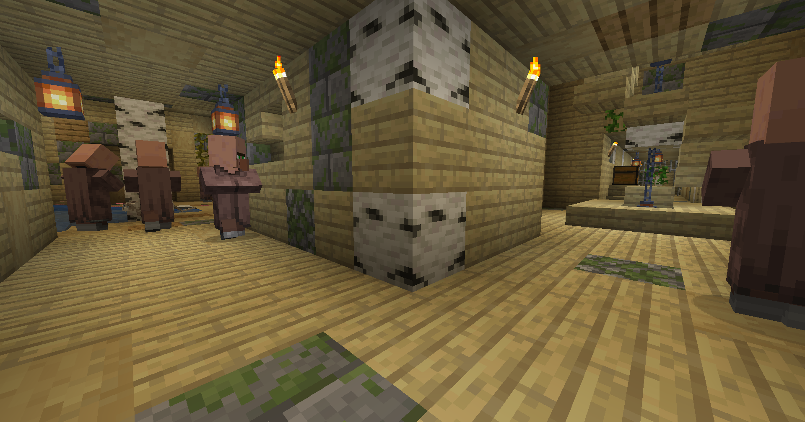
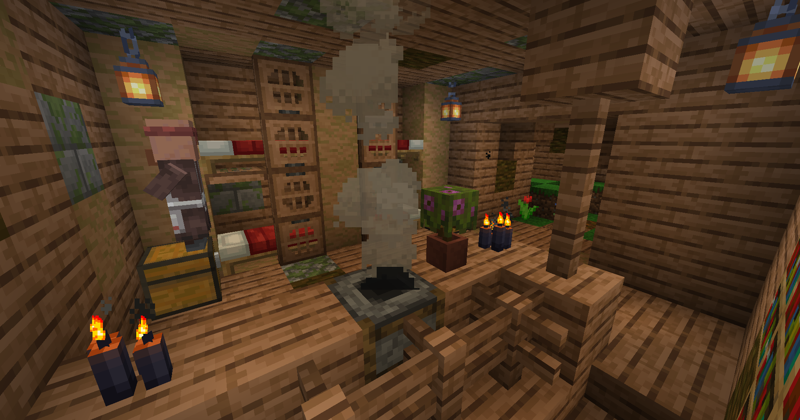
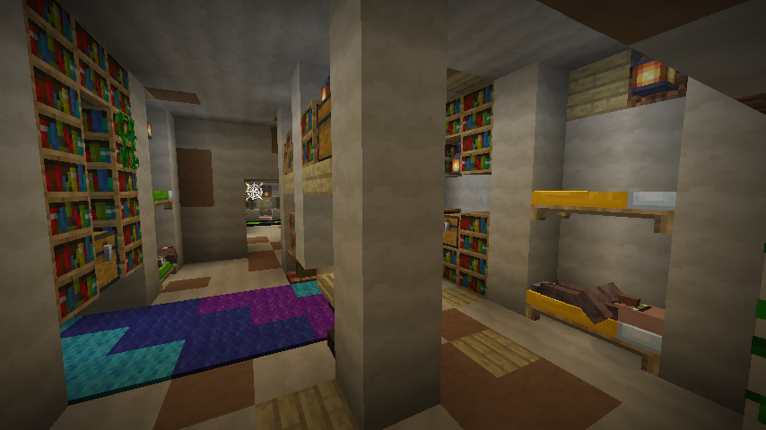
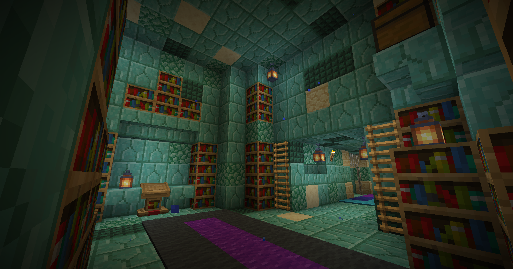
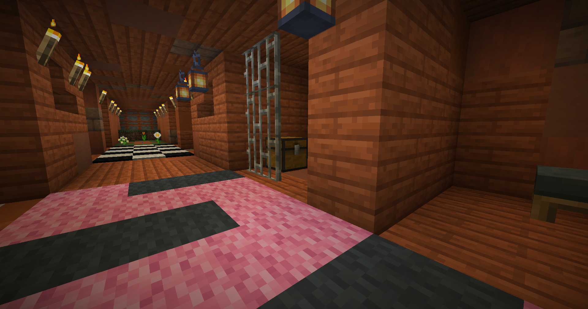
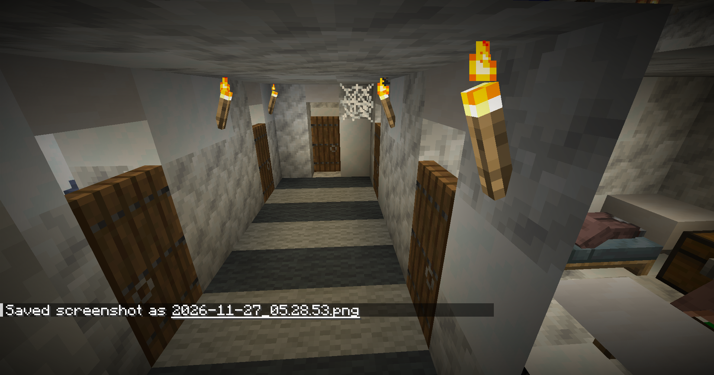
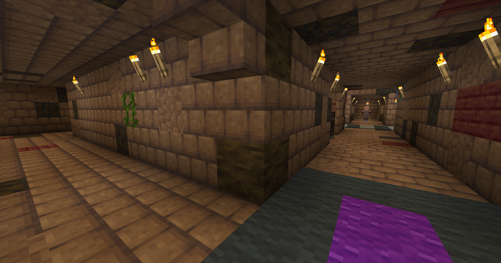

# Underground Village (Stoneholm)

  
  
  
  

  

Need a high-performance server to play with friends? Rent a server with **ZAP-Hosting**!  
Use promo code **`Reggarf-1047`** at checkout for **20% off** your order:  
👉 **[https://zap-hosting.com/reggarf](https://zap-hosting.com/reggarf)**

---

**Underground Village** is a modern multi-loader port and continuation of **[Stoneholm](https://github.com/TheGrimsey/StoneholmForge)** (originally created by [TheGrimsey](https://github.com/TheGrimsey)), adding sprawling procedurally generated underground villages to Minecraft. Inspired by Strongholds and surface Villages, it brings life, mystery, and civilization to the depths.

Explore underground settlements that adapt to the biome above them—featuring complex networks of hallways, multi-tier staircases, artisan workspaces, bedrooms, overgrown chambers, and forgotten crypts. Convert them into your subterranean fortress, build a settlement above ground, or trade with deep-dwelling villagers.

---

### Supported Minecraft Versions & Mod Loaders

| Minecraft Version | NeoForge | Fabric | Forge | Status |
| :--- | :---: | :---: | :---: | :---: |
| **26.1 – 26.3** | ✔️ | ✔️ | — | **Latest / Active** |
| **1.21.1** | ✔️ | ✔️ | ✔️ | Supported |
| **1.20.1** | — | ✔️ | ✔️ | Legacy Supported |

> **Note**: Backports to older Minecraft versions prior to 1.20.1 will not be done.

---

# Requirements

- **Minecraft**: `1.21.1` or `26.1 – 26.3`
- **Required Library**:
  - **[Better Library](https://modrinth.com/mod/better-library)** ([CurseForge](https://www.curseforge.com/minecraft/mc-mods/better-library)) *(Required on all versions & loaders)*
- **Mod Loader**:
  - [NeoForge](https://neoforged.net/)
  - [Fabric](https://fabricmc.net/) (+ [Fabric API](https://modrinth.com/mod/fabric-api))
- **Java**: Java 21+ (Java 25 for `26.1 – 26.3`)

---

# Features

- 🎨 **14 Biome-Themed Underground Villages**: Villages automatically adapt their blocks and architectural style to match the surface biome directly above them—including **Desert, Badlands, Jungle, Plains, Forest, Taiga, Snowy, Savanna, Swamp, Dark Forest, Cherry Grove, Mushroom Fields, Mountain,** and **Ocean** biomes (plus automatic matching for modded biomes!).
- 🌊 **Unified Ocean Village**: Explore sunken **Ocean Villages** built with Prismarine and Sandstone blocks.
- 🧭 **Biome-Specific `/locate` Commands**: Search for any biome village directly with `/locate structure underground_village:<biome>_village` (such as `desert_village`, `cherry_grove_village`, `ocean_village`, `snowy_village`) or `/locate structure underground_village:village`.
- 🗺️ **Smart Buried World Generation**: Keeps underground rooms and hallways safely buried underground so only the surface entrance peeks above ground, with natural vanilla-like village spacing and fast lag-free `/locate` searches.
- ⚙️ **Fully Configurable**:
  - Interactive in-game config menu (via **Better Library** / ModMenu).
  - Toggle biome-themed palettes on or off.
  - Adjust village structure size, max distance from center, spacing, and separation.
- ⚖️ **Balanced Loot Progression**: Grounded loot tables featuring supplies, utility scrap, and food rather than game-breaking early progression gear.

---

# Screenshots

### Badlands Underground Village

### Cherry Grove Underground Village

### Desert Underground Village

### Forest Underground Village

### Jungle Underground Village

### Mushroom Fields Underground Village

### Ocean Underground Village

### Savanna Underground Village

### Snowy Underground Village

### Swamp Underground Village

### Classic Hallways & Interiors

---

# Technical Info

Underground Villages are jigsaw structures that make use of template pools and processors as well as structure files. Creating jigsaw structures can be challenging, but [TelepathicGrunt's StructureTutorialMod repo](https://github.com/TelepathicGrunt/StructureTutorialMod) has been an invaluable reference when developing this mod.

---

## License & Credits

- **License**: This mod is licensed under the [MIT License](LICENSE). You are free to port, modify, or include it in modpacks.
- **Original Mod**: Credits and special thanks to [TheGrimsey](https://github.com/TheGrimsey) for the original [Stoneholm](https://github.com/TheGrimsey/StoneholmForge) mod.
